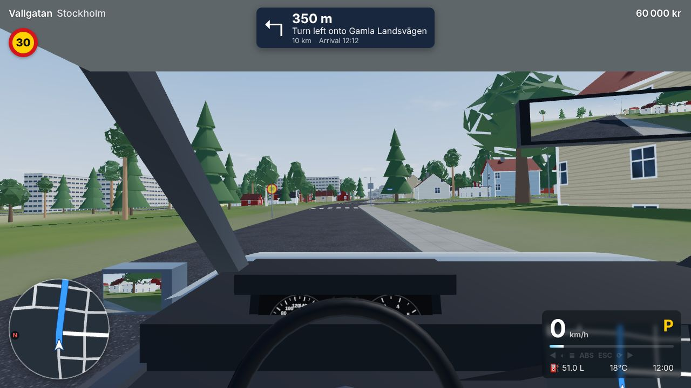
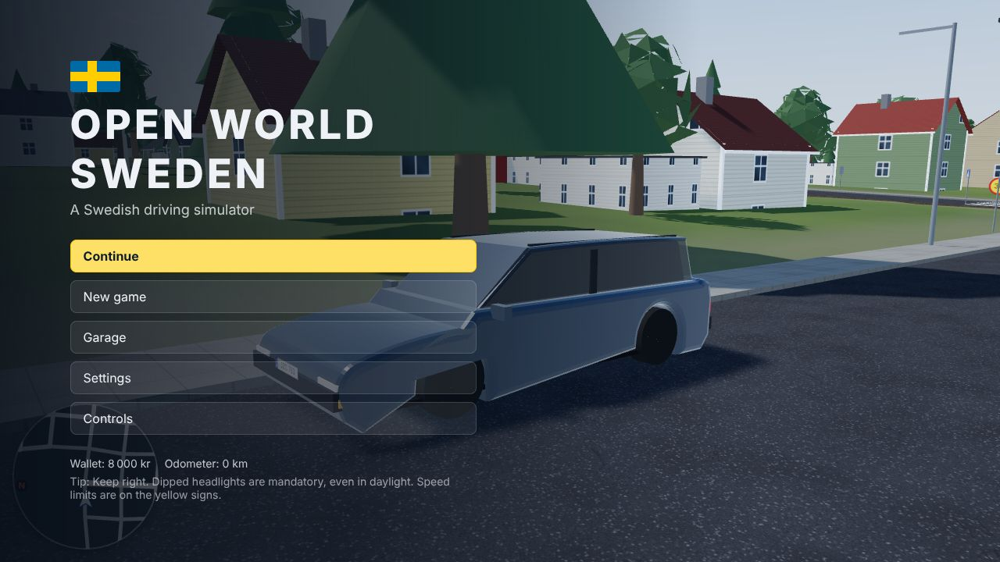
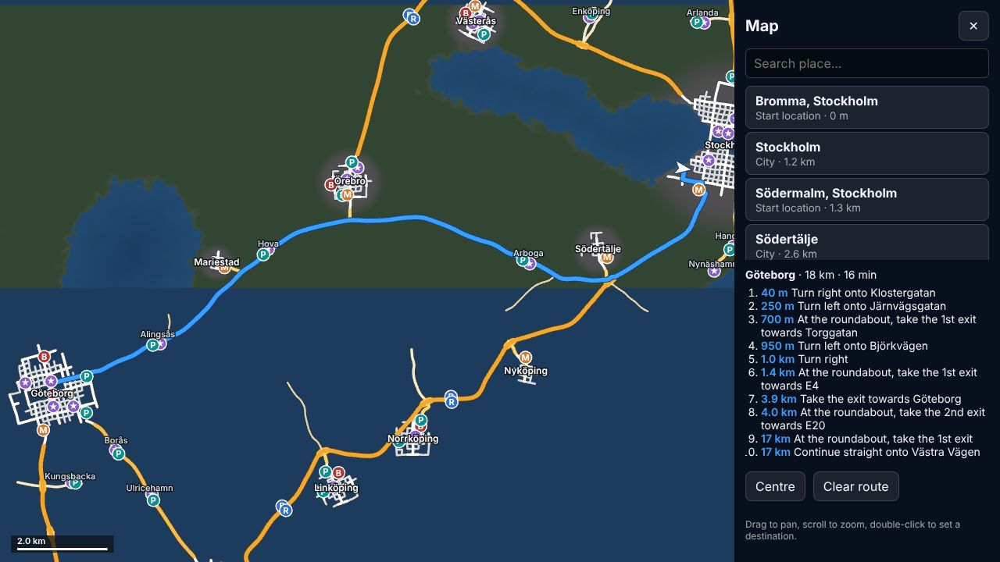
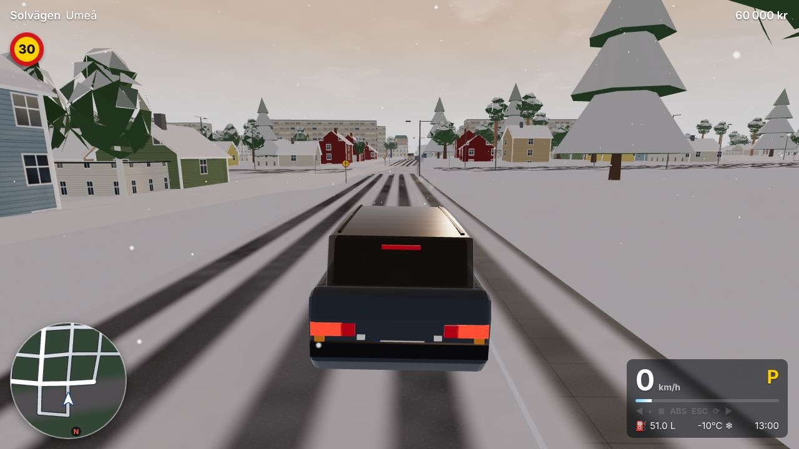
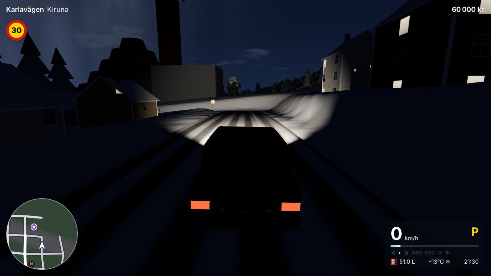
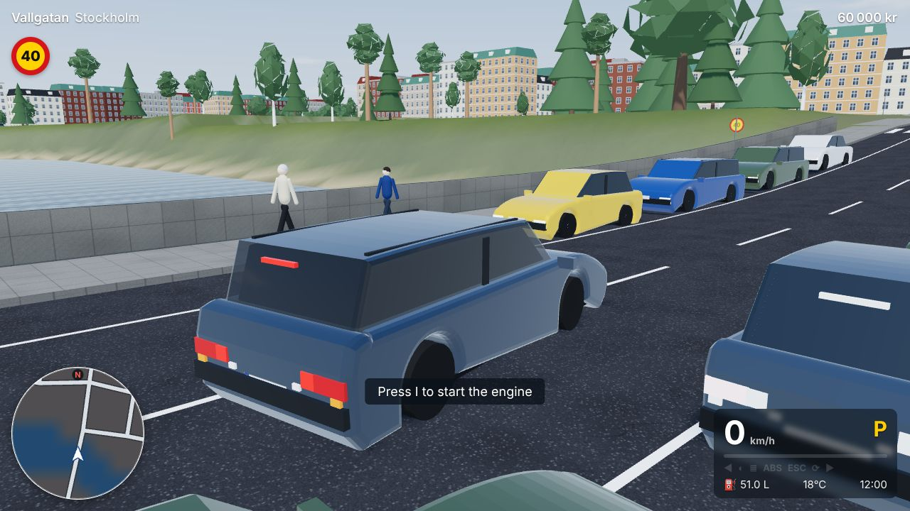
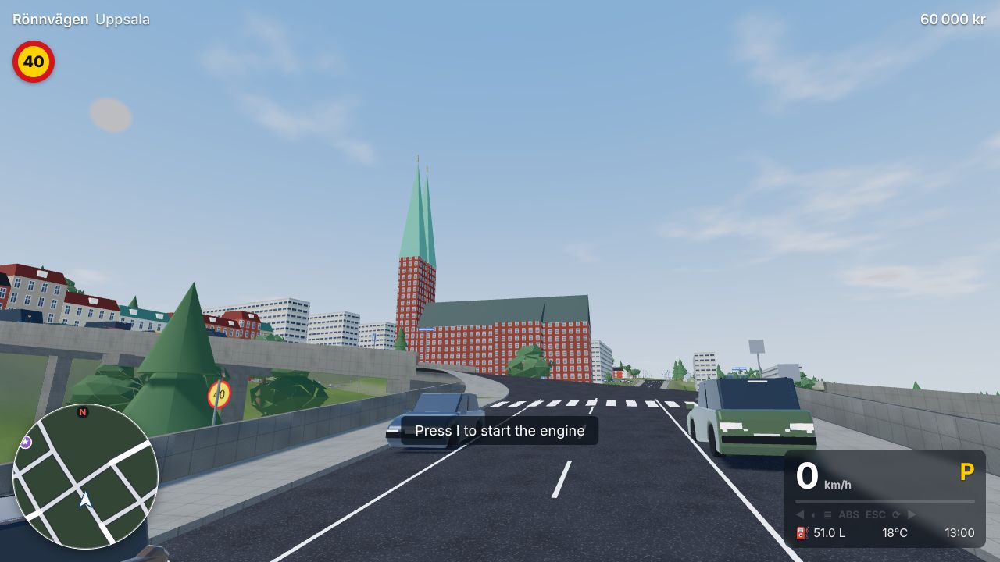
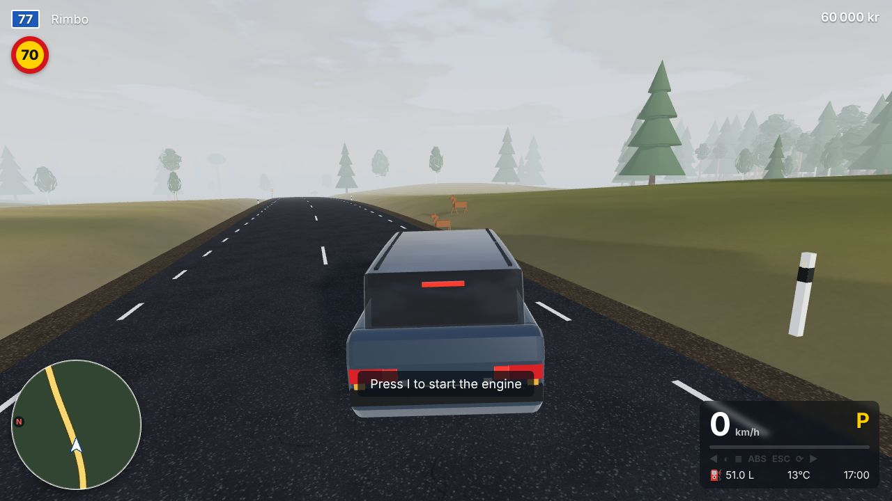
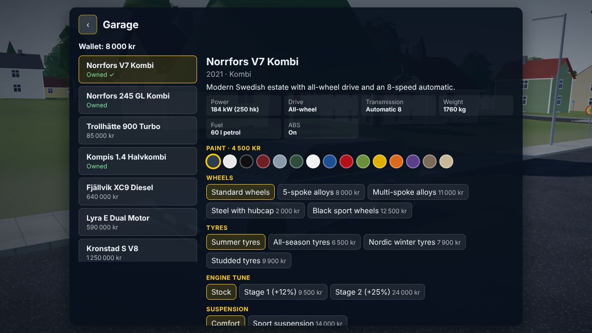

# Open World Sweden 🇸🇪

**En svensk körsimulator.** This is an open-world driving simulator set in a compressed, procedurally built Sweden. You can drive from Malmö to Kiruna on Swedish roads, with Swedish traffic rules, weather, seasons and light. It runs in the browser using three.js, with no build step.



| | |
|---|---|
|  |  |
|  |  |
|  |  |
|  |  |

## Running it

The game is plain ES modules, so any static web server will do:

```sh
python3 -m http.server 8080      # or: npm start
# then open http://localhost:8080
```

Opening `index.html` straight from the file system won't work, because browsers block module and worklet loading over `file://`. You need a WebGL 2 browser. Recent Chrome, Edge, Firefox and Safari all work, on desktop or mobile.

## Controls

| Action | Keyboard | Gamepad |
|---|---|---|
| Throttle / brake | W / S (or ↑ / ↓) | RT / LT |
| Steer | A / D (or ← / →) | Left stick |
| Handbrake | Space | A |
| Ignition (start / stop engine) | I | Left stick press |
| Shift up / down (manual, or tiptronic in automatics) | E or Shift / Q or Ctrl | RB / LB |
| P / R / N / D (automatic) | 7 / 8 / 9 / 0 | — |
| Clutch (when auto clutch is off) | C | — |
| Indicators left / right, hazards | Z / X, J | D-pad ← / → |
| Headlights (auto → dipped → off), high beam | L, K | Right stick press |
| Wipers (off → interval → normal → fast) | U | D-pad ↑ |
| Horn | H | X |
| Cruise control | O | D-pad ↓ |
| Camera (cockpit, hood, chase, cinematic) | V (F2–F5 for each directly) | Y |
| Look back, look left / right | B, 1 / 3, mouse drag | B, right stick |
| Map | M | Back |
| Interact (refuel, dealership, rest) | F | — |
| GPS home, or cancel route | G | — |
| Reset car to road | R | — |
| Pause | Esc / P | Start |

**Steering wheels and pedals** can be bound under *Settings → Wheel & pedals*. On **phones and tablets**, on-screen controls appear: drag the wheel on the left, and use the analogue pedals on the right.

## What's in it

### The world
- About 480 km of roads across a compressed Sweden. It includes 24 cities: Stockholm, Göteborg, Malmö, Uppsala, Västerås, Örebro, Linköping, Norrköping, Jönköping, Gävle, Sundsvall, Umeå, Luleå, Kiruna and more. Villages, hamlets, farms and summer cottages lie in between.
- The real network shape is there: **E4, E6, E10, E18, E20, Rv 40, Rv 55, Rv 73, Rv 77 and Rv 222**. That means motorways with diamond interchanges, 2+1 roads with cable barriers, roundabouts, bridges, grade-separated crossings, rest areas, gravel roads and dead-end streets.
- Cities have stenstaden blocks, lamellhus and miljonprogram slabs, villa suburbs with falu-red and yellow wooden houses, and industrial areas. There are supermarkets, Polar petrol stations, Bilhallen dealerships, parks and churches.
- Landmarks include Stadshuset, Globen, Kaknästornet, Uppsala domkyrka and slott, Läppstiftet, Eriksbergskranen, Gothia Towers, Turning Torso, Kiruna kyrka and the mine, Örebro slott, Svampen, Skrapan, Kärnan, Sergels torg, and Gävlebocken in December.
- Lakes include Mälaren, Vänern and Vättern, plus rivers, archipelagos, forests (spruce, pine, birch, broadleaf) and fields. There are **no invisible walls**: you can drive off-road anywhere.
- Signs and markings are Swedish: yellow speed signs, moose warnings, give-way shark teeth, zebra crossings, green E-road and blue national-road shields, direction signs, ATK speed cameras, reflector posts and winter snow poles.

### Driving physics
- A 240 Hz rigid-body simulation with raycast suspension, anti-roll bars and weight transfer. Tyres use a combined-slip model with load sensitivity.
- Each wheel is solved implicitly, with clutch friction, a torque converter with lock-up, and open or limited-slip differentials. FWD, RWD and AWD are all modelled.
- Manual gearboxes support an optional automatic clutch, stalling and gear grinding. Automatics have P/R/N/D and a tiptronic mode. EVs have regenerative braking.
- ABS, traction control and stability control can each be switched off.
- Grip depends on surface (dry, wet, gravel, grass, snow, ice) and on tyre type: summer, all-season, Nordic friction or studded. Ice on summer tyres behaves the way it does in real life.
- Fuel consumption, damage (front, rear, sides, engine, glass), water and hard collisions are all modelled.
- Checks in `tests/physics.test.mjs` include: V7 0–100 km/h in 6.2 s, braking from 100 km/h in 38 m dry and 47 m wet, and a 95 m stop on ice with studs (versus 425 m on summer tyres).

### Traffic
- AI cars, vans, trucks, buses, motorcycles, tractors and winter snow ploughs drive on the right using an Intelligent Driver Model.
- They obey traffic signals (red → red+amber → green → amber), speed limits, priority roads, the right-hand rule, roundabouts, merges and zebra crossings. They also change lanes, overtake, keep right, and serve bus stops.
- Pedestrians and cyclists use the sidewalks. They wait at crossings and cross when it's safe, and drivers yield to them.
- Moose and roe deer cross rural roads, mostly at dawn, dusk and night. AI drivers brake for them, and hitting a moose is serious.
- Parked cars fill lots, rest areas, dealership showrooms and kerbside parking lanes.

### Vehicles (fictional brands)
| Model | Type |
|---|---|
| Norrfors V7 Kombi | AWD estate, 8-speed automatic |
| Norrfors 245 GL | Classic RWD estate, manual, no ABS |
| Trollhätte 900 Turbo | FWD turbo with lag |
| Kompis 1.4 | Small manual hatchback |
| Fjällvik XC9 Diesel | Diesel SUV |
| Lyra E Dual Motor | Dual-motor EV |
| Kronstad S V8 | RWD luxury saloon |
| Lastvik Transit Skåp | Panel van |
| Svea 444 Special | 1950s classic |
| Stadsbuss 12 Hybrid | City bus |
| Kvarnby FH Distribution | Lorry |

In the garage you can buy cars and change paint, wheels, tyres, engine tune, suspension and the number plate (Swedish EU format). Prices are in kronor.

### Environment
- The sun and moon follow their real positions for the date, time and latitude. That gives long summer days, midnight sun in the north, dark winters, stars, the Milky Way and the aurora.
- There are four seasons, with foliage colours, snow cover, and frozen lakes and sea. The climate depends on latitude and date, so Kiruna in January is around −15 °C.
- Weather changes over time: clear, cloudy, overcast, rain, thunderstorms with lightning and thunder, snowfall and fog. Roads get wet, collect snow with cleared wheel tracks, and can turn icy. Wipers clear rain from the windscreen.

### Gameplay
- From the main menu, pick a start location, destination, car, season, time and weather. "Now" uses the real date and time.
- GPS uses A* routing on the lane graph. Turn-by-turn guidance uses Swedish road names and numbers ("Ta avfarten mot Uppsala", "I rondellen, ta 2:a avfarten"). Optional Swedish voice guidance uses the browser's speech synthesis.
- Navigation includes a minimap, a full-screen map with search and double-click destinations, rerouting, and an ETA.
- Refuel petrol or diesel, or charge an EV, at Polar stations (engine off, price per litre or kWh). Buy, swap and repair cars at Bilhallen. Rest at rest areas.
- Optional fines in Swedish amounts for speed cameras (with the ATK tolerance) and red lights. Completing a trip earns money, more if you drove without fines.
- Reverse parking sensors, parking detection, cruise control, odometer and save game (localStorage).
- Cameras: cockpit (working gauges, centre navigation screen, rear-view and side mirrors), hood, chase, cinematic trackside, and an orbit view in the menus.
- The interface is in Swedish and English, picked automatically from the browser language.

### Audio
Everything is synthesised; there are no samples:
- Engines are synthesised per engine type (I4, turbo, diesel, V8, classic, truck, motorcycle, tractor) in an AudioWorklet, plus EV whine, turbo whistle and blow-off.
- Driving sounds: tyre squeal, surface-dependent road noise, wind, rain on the roof, wipers, indicator relay, horn, collisions and gears.
- World sounds: thunder, birds, city hum, and spatial traffic with Doppler. Exterior sound is muffled inside the cabin.

### Performance
- The world streams in 256 m chunks with LODs: terrain, roads, buildings, vegetation and props are generated on demand in time-sliced jobs.
- Vehicles, pedestrians, trees and props are instanced, and distant cars use simplified meshes.
- Four quality presets are available. *Auto* quality adapts the render resolution to hold the frame rate.

## Project layout

```
index.html, style.css, manifest.webmanifest, icon.svg
lib/                  three.js r170 (MIT) and addons
src/main.js           entry: builds the world, creates Game and App
src/game.js           renderer, scene, main loop, modules
src/core/             maths and noise, settings and save data, i18n (sv/en)
src/world/            geography, road network and elevation, city/village generators,
                      map data (cities, routes), terrain, weather and climate
src/render/           chunk streaming, terrain, roads, buildings, landmarks, vegetation,
                      props and signs, sky, environment lighting, water, textures
src/vehicle/          vehicle specs, physics, car meshes, cockpit, cameras, collisions
src/traffic/          lane graph and signals, traffic AI, instanced fleet, pedestrians,
                      wildlife, parked cars
src/nav/              routing (A*), navigation and guidance
src/gameplay/         refuelling, dealership, fines, sensors, earnings
src/audio/            Web Audio engine and engine worklet
src/ui/               menus, HUD, minimap and map, app flow
src/input/            keyboard, gamepad, wheel, touch
tests/                headless Node tests (physics, world, routing)
tools/                screenshot and drive harnesses (Playwright)
```

## Tests and dev tools

```sh
npm test                         # physics, world and routing checks (Node 18+)
node tools/shot.mjs "?shot=1&t=22&day=20&start=kiruna" out.png    # screenshot (needs Playwright)
node tools/drive.mjs             # headless drive with telemetry
```

Useful URL parameters:
- `start=<id>` picks a start location.
- `car=<id>` picks a car.
- `t=<hour>` and `day=<day of year>` set the time and date.
- `w=clear|rain|snow|fog|storm` sets the weather.
- `cam=cockpit|hood|chase|cinematic` sets the camera.
- `dest=city:uppsala` sets a destination.
- `autopilot=<km/h>` drives automatically.
- `at=<east km>,<north km>` teleports you.
- `menu=main|setup|garage|map` opens a menu.

## Notes and limitations

- **The map is compressed.** Distances are scaled down a lot (Stockholm to Uppsala is about 6 km) so that the whole country fits in one drivable world. City layouts are procedural and "Swedish in character", not street-accurate.
- Visuals are stylised low-poly with procedural textures. Landmarks are simplified silhouettes inspired by the real buildings.
- All vehicle brands and models are fictional.
- Fine amounts follow the Swedish ordningsbot tables approximately. They are for gameplay, not legal reference.

three.js is © the three.js authors (MIT, see `lib/THREE-LICENSE`).
